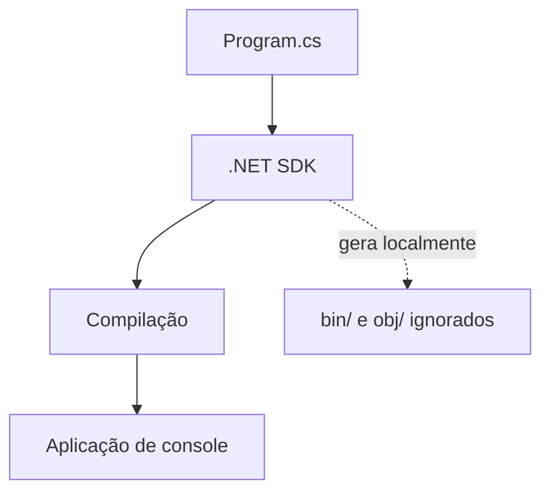

# MicroSoftLearn — Estudos de C#

Repositório de aprendizagem de C# e fundamentos de programação. O conteúdo atual é um aplicativo de console .NET, não uma aplicação web.

## Estrutura
## Arquitetura

O projeto é um executável de console: o SDK restaura dependências, compila o código-fonte e produz os artefatos localmente. Não existe camada web, API ou banco de dados.




- `C#/FirstCode.slnx`: solução .NET.
- `C#/FirstCode/FirstCode.csproj`: projeto executável configurado para `net10.0`.
- `C#/FirstCode/Program.cs`: exemplos comentados de tipos de dados, variáveis, console, data/hora e operadores.

A árvore também contém diretórios `bin/` e `obj/`, gerados pelo .NET. Em geral, esses artefatos devem ficar fora do versionamento; o código-fonte e os arquivos de projeto bastam para reconstruir a aplicação.

## Requisitos e execução

Instale o .NET SDK compatível com .NET 10 e execute:

```bash
cd "C#/FirstCode"
dotnet restore
dotnet run
dotnet build
```

## Escopo

É um projeto educacional de console. Não há API, banco de dados, interface gráfica ou suíte de testes documentada. Recomenda-se adicionar um `.gitignore` adequado ao .NET e deixar de versionar `bin/` e `obj/`.

Relacionado: [LV_Portfolio](https://github.com/Lvc4br/LV_Portfolio).

**Autor:** Luca Toniolo — [@Lvc4br](https://github.com/Lvc4br)